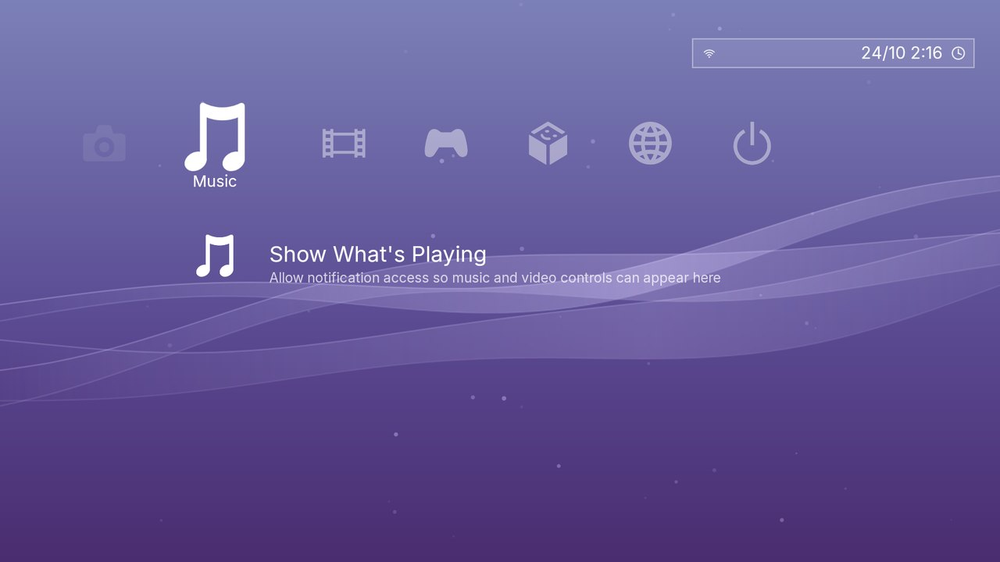
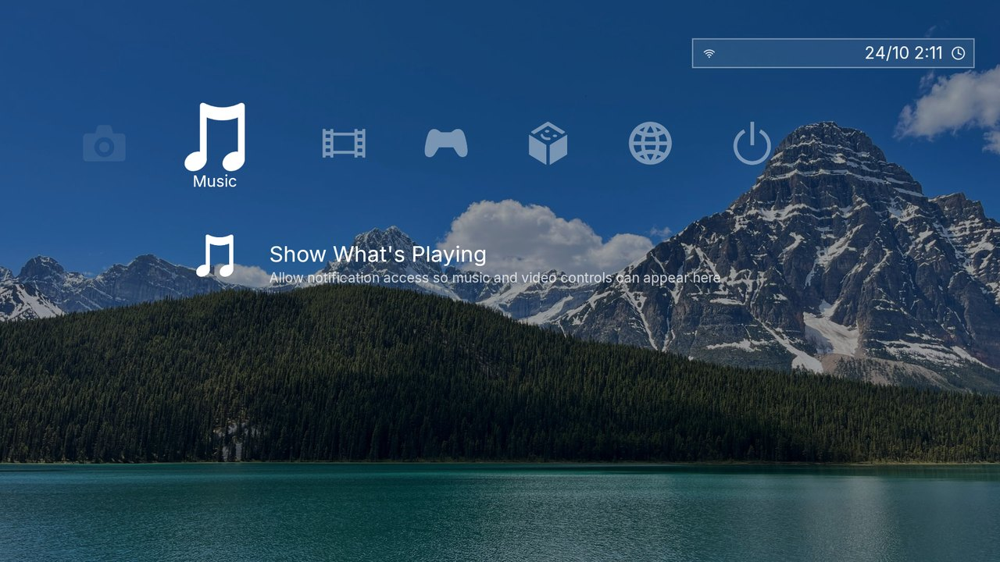
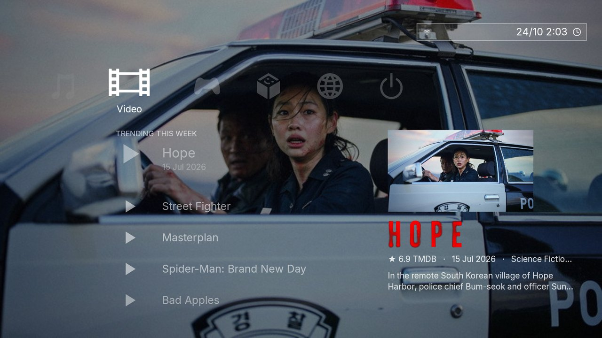
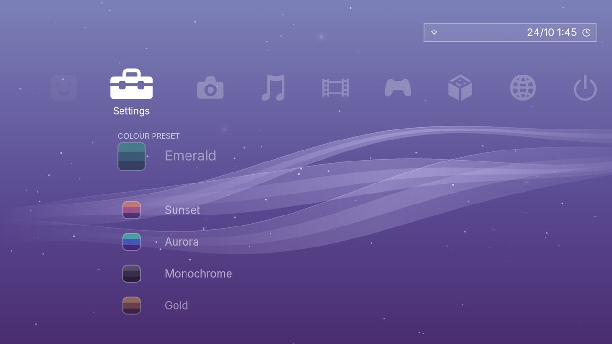
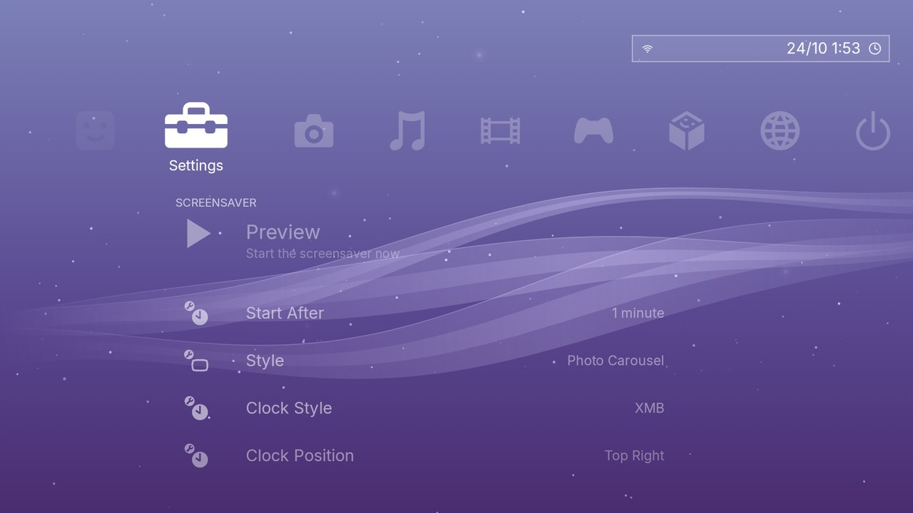

<div align="center">



### A cross-bar home screen for Android TV

Horizontal categories. Vertical lists. Flowing waves. Everything redrawn only when something moves.

[](#install)
[](LICENSE)
[](#why-it-feels-fast)
[](docs/build-and-install.md)

<br>



</div>

> **Independent project.** XS3OS is not affiliated with, endorsed by or sponsored by Sony Interactive
> Entertainment or PlayStation. "PlayStation", "PS3" and "XrossMediaBar" are trademarks of their
> owners, mentioned only to describe the look this launcher is inspired by. See [CREDITS](CREDITS.md).

---

## What it is

XS3OS replaces the stock Android TV home with a single-canvas, remote-first launcher: a rail of
categories across the top, a list under whichever one you pick, and a detail panel on the right. It
is built for modest hardware, so nothing animates unless you are moving the cursor.

<table>
<tr>
<td width="50%"><br><sub><b>Wallpapers</b> from Pexels, with an optional timed carousel.</sub></td>
<td width="50%"><br><sub><b>Movie Theme</b>: the focused title's artwork becomes the backdrop.</sub></td>
</tr>
<tr>
<td width="50%"><br><sub><b>21 colour presets</b> plus a custom gradient, each with a swatch.</sub></td>
<td width="50%"><br><sub><b>Settings</b> use the same bar: no separate settings app.</sub></td>
</tr>
</table>

## Highlights

| | |
|---|---|
| **Cross-bar navigation** | Nine categories (Users, Settings, Photos, Music, Video, Games, Apps, Network, Power), instant D-pad response, optional move sounds. |
| **Waves, two ways** | Pre-rendered waves and scattered particles baked at your display size (1080p or 4K), or live animated waves with reactive particles behind a switch that is off by default. |
| **Wallpapers** | 53 bundled Pexels photos across several categories, downloaded on demand. A photo replaces the waves entirely and fades in. |
| **Carousels** | Change the wallpaper every 10 s to 1 h, from Pexels photos or, with Movie Theme, from trending movie artwork. |
| **Movie Theme** | Optional TMDB integration with your own free key: posters, logos, ratings and overviews, and a backdrop that follows your focus. |
| **Screensaver** | Animated waves, static waves, photo carousel, movies, single photo or a minimal clock, with clock styles and slow position drift to protect panels. |
| **First-run setup** | A short guided setup in the same cross-bar style: appearance, colours, optional keys, screensaver. |
| **Bring your own sounds and icons** | Drop UI sounds and an icon pack into the project to get the full effect; see [custom assets](docs/custom-assets.md). |

## Why it feels fast

- **One view, drawn on demand.** The whole menu is a single canvas. When nothing moves, it draws zero frames.
- **Baked backgrounds.** Waves and particles are rendered once into an image at your resolution and cached. In the settled state the gradient and ribbons are flattened into one opaque bitmap, so a frame is a single full-screen draw.
- **Cheap icons.** Each icon is drawn once into a small alpha mask; a frame then costs a textured quad, not a path fill.
- **No hidden overdraw.** No window background fill, and wallpaper dimming is a colour filter on the photo rather than a second layer.
- **Animated waves off the UI thread.** When enabled, ribbons are painted on a worker thread and swapped in; sharp edge lines are drawn at full size on top.
- **Measured.** On the emulator, the menu's own drawing averages 0.2 to 0.45 ms per warm frame and the app sits around 35 to 46 MB of memory. Real-TV numbers depend on your GPU; see [performance notes](docs/performance.md).

## Install

Requirements: Android TV or Google TV 7.0 or newer (API 24).

```bash
./build.sh                          # produces build/as3.apk
adb connect <tv-ip>:5555            # or use USB
adb install -r build/as3.apk
```

Then press Home and choose **XS3OS** as the default launcher. To build with your own UI sounds and
icon pack, follow [Building with sounds and icons](docs/build-and-install.md#building-with-sounds-and-icons).
Step by step, including prerequisites: [docs/build-and-install.md](docs/build-and-install.md).

## Documentation

| Guide | What is in it |
|---|---|
| [Features](docs/features.md) | Every screen and setting, explained |
| [Build and install](docs/build-and-install.md) | Toolchain, signing, sideloading, test hooks |
| [Architecture](docs/architecture.md) | How the code is organised and why |
| [Performance](docs/performance.md) | Rendering budget, low-memory behaviour, how to measure |
| [Custom assets](docs/custom-assets.md) | Adding your own sounds and icon pack |
| [Credits](CREDITS.md) | Photographers, fonts, libraries, data sources |

## Project layout

```
src/com/hydrainnit/refract/   launcher, menu renderer, waves, icons, screensaver, sounds
assets/                       fonts, photo index, presentation web UI
res/                          logo, banner, icon, strings
tools/brand/make_logo.py      regenerates the logo, banner and launcher icon
tools/icons/pack_icons.py     packs an SVG icon set into the app's icon file
build.sh                      builds, aligns and signs the APK
```

## License

Apache License 2.0, see [LICENSE](LICENSE) and [NOTICE](NOTICE). Photos are used under the
[Pexels License](https://www.pexels.com/license/); movie data is provided by TMDB.

<div align="center"><sub>Made by <b>Hydrainnit</b></sub></div>
